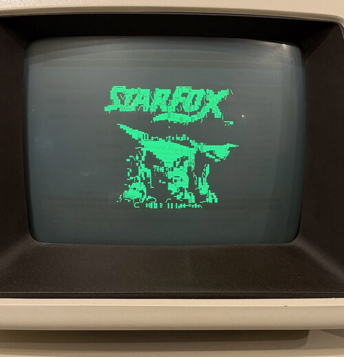
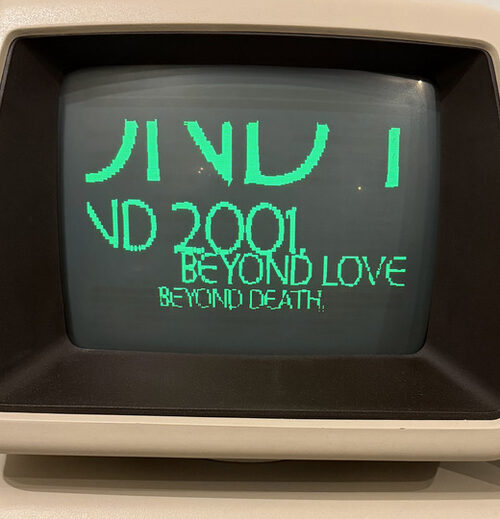
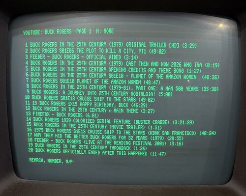
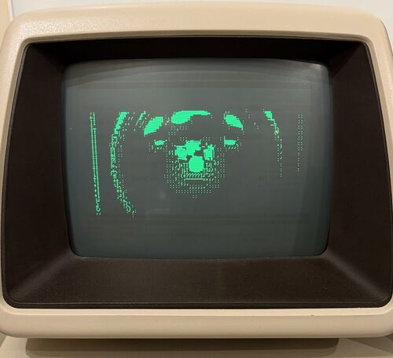

# PETdisk Video (PDV)




PETdisk Video lets you search YouTube on a Commodore PET and watch the videos on its screen in PETSCII. A PC does the work: it gets the video, converts it to PETSCII while it plays, and streams it to the PET through a PETdisk MAX network drive. The PC can also play a video file. You control everything from the PET keyboard: search, pause, seek, loop a part of the video, and adjust the brightness, contrast, gamma and dithering.

## Quick start

You need Docker on the PC, and a PETdisk MAX with device 10 set to this PC (see "One-time PETdisk MAX setup").

1. Start the server on the PC: `./run-docker.sh`. The first start takes a few minutes.
2. On the PET, load PDV for the width of your screen, and start it. For 80 columns, type `LOAD"PDV80",10`. For 40 columns, type `LOAD"PDV40",10`. Then type `RUN`.
3. Type search words and press RETURN. Then type the number of a video and press RETURN.
4. Enjoy the video.
5. Press H to show or hide the help and status.

Easy peasy!

## PDV and the PETdisk MAX

The [PETdisk MAX](https://github.com/bitfixer/petdisk-max) by bitfixer is a storage device for the PET. It plugs into the IEEE-488 port and reads files from a microSD card, or over WiFi from "network drives" on web servers. A network drive is a directory on a web server with the PHP script `petdisk.php`.

PDV uses the network drive feature. `server.py` answers the same requests as `petdisk.php`, so the PETdisk MAX sees it as an ordinary network drive. One of its files, the video stream, never ends and is made while the PET reads it. PDV runs on the stock, unmodified PETdisk MAX firmware.

PDV is an independent project. It is not associated with the PETdisk MAX, its author or bitfixer.

## Requirements

Hardware:

- A Commodore PET or CBM with BASIC 2 or BASIC 4, and at least 16 KB of RAM. The PETdisk MAX does not support BASIC 1 (an original, not upgraded PET 2001).
  - `PDV80` is for PETs with an 80-column screen, for example the 8032, 8096 and 8296.
  - `PDV40` is for PETs with a 40-column screen, for example the 2001N, 3032 and 4032.
- A PETdisk MAX on the IEEE-488 port of the PET.
- A 2.4 GHz WiFi network. The PETdisk MAX does not support 5 GHz.
- A PC on the same network, which runs the server.

The PET programs `PDV80` and `PDV40` are ready in `serve/`. You do not need to build them.

Software on the PC to run the server with Docker:

- Docker.
- PETdisk Video: the files of this project.

Software on the PC to run the server without Docker:

- PETdisk Video: the files of this project.
- Python 3 with the numpy and Pillow packages.
- ffmpeg, which decodes the video.
- yt-dlp, for YouTube. Keep it up to date, because YouTube changes often.
- A JavaScript runtime for yt-dlp: deno, or Node.js. yt-dlp needs it for YouTube.

On Debian or Ubuntu, for example:

```
sudo apt install python3-numpy python3-pil ffmpeg nodejs
pip install --user yt-dlp
```

Software on the PC to change PDV and run the tests:

- The software to run the server without Docker. The tests need Python, numpy, Pillow and ffmpeg.
- ACME (the 6502 assembler `acme`) and `petcat` from VICE, to build the PET programs after a change to `client.a` or `stub.bas.in`. On Debian or Ubuntu: `sudo apt install acme vice`.
- Optional, for the emulator tests: Docker, and the PET ROMs of a local VICE. The VICE from Flathub (`net.sf.VICE`) has the ROMs. The Debian and Ubuntu package does not.
- Optional: Docker, to test the server image.

Tested with:

| Item | Version |
|---|---|
| PET | a real 8296 (BASIC 4), and an 8032 in VICE |
| PETdisk MAX | ESP32 version (v2), firmware build 78a8022 from 2022 |
| PC | Linux, Python 3.13, numpy 2.4, Pillow 12.1, ffmpeg 7.1, yt-dlp 2026.08.19, Node.js 22, ACME 0.97, VICE 3.9 |

Other PET models, BASIC 2 and the ATmega version (v1) of the PETdisk MAX are not tested.

## Files

- `server.py` imitates `petdisk.php`. It serves the files in `serve/`, the endless virtual files `VIDEO80.SEQ` (80 columns) and `VIDEO40.SEQ` (40 columns), and the search screen files `RESULTS80.SEQ` and `RESULTS40.SEQ`.
- `convert.py` holds the PETSCII conversion, the ffmpeg decoding and the yt-dlp calls that the server uses.
- `petscii_unicode.py` maps PET screen codes to Unicode characters for the server's terminal view.
- `serve/PDV80.PRG` and `serve/PDV40.PRG` are the built PET programs for 80 and 40 columns.
- `run-docker.sh` builds the server image when necessary, runs the server in a container and removes the container when the server stops.
- `Dockerfile` and `docker-entrypoint.sh` make the server image.
- `client.a` is the machine code part of the PET client, in ACME assembly.
- `stub.bas.in` is the BASIC part of the PET client: the main loop and the search screen.
- `build.sh` builds the PET programs again from `client.a` and `stub.bas.in`, and also `build/PDV8.PRG`, a test version that reads from device 8.
- `tests/` holds the tests, see "Tests".
- `build/timing.log` gets one line per request from the server. It grows without limit. Delete it when you do not need it.

## One-time PETdisk MAX setup

**You most likely have this configured already. If your PETdisk MAX already uses device 10 as a network drive on the PC that runs the PDV server, you do not need to change the configuration.**

Otherwise, edit `PETDISK.CFG` on the SD card. Replace the IP address with the LAN address of the PC that runs the server:

```
8,SD0
10,192.168.X.Y:8000/petdisk.php
ssid,<2.4 GHz network>
password,<password>
```

Power-cycle the PET. While the server runs, `LOAD"$",10` must list the programs `PDV80` and `PDV40`. The video and search files are not listed, because the player opens them by name.

## Start the server

Start the server with Docker or with Python. Both use the PET programs in `serve/` as they are.

### With Docker

The script `run-docker.sh` builds the image and starts the server in a container:

```
./run-docker.sh
./run-docker.sh 'https://www.youtube.com/watch?v=...'
./run-docker.sh video.mp4 --dither 1
./run-docker.sh --clean
```

Without a video, the PET goes directly to the YouTube search. A video loops, also from a URL. The arguments are the options of `server.py`, see "With Python". The first start builds the image `pdv`, which takes a few minutes. Later starts build the image again only when a file of the server changed. A video file can be in any directory, because the script mounts its directory in the container. With `--port`, the script publishes that port instead of port 8000.

Press Ctrl+C to stop the server. The script then removes the container. The image stays, so the next start is fast. `./run-docker.sh --clean` removes the image.

At every start, the container updates yt-dlp first, because YouTube changes often and the image does not. To skip the update, for example without Internet access, start the script as `PDV_NO_UPDATE=1 ./run-docker.sh`.

Without the script, use the Docker commands:

```
docker build -t pdv .
docker run --rm -it -p 8000:8000 pdv
docker run --rm -it -p 8000:8000 pdv https://www.youtube.com/watch?v=...
docker run --rm -it -p 8000:8000 -v "$PWD:/videos" pdv /videos/video.mp4 --dither 1
```

Everything after `pdv` are the options of `server.py`. `-it` gives the server its terminal view and the hotkeys. `-p 8000:8000` makes the server reachable on the LAN address of the PC. A video file must be in a mounted directory: `-v "$PWD:/videos"` mounts the current directory as `/videos`. Set `-e PDV_NO_UPDATE=1` to skip the yt-dlp update.

### With Python

Start the server in one of these ways:

```
python3 server.py
python3 server.py video.mp4
python3 server.py 'https://www.youtube.com/watch?v=...'
```

Start values are options, for example:

```
python3 server.py video.mp4 --brightness 0.1 --contrast 1.5 --gamma 1.2 --dither 1
```

`--zoom fill` or `--zoom stretch` sets the start zoom mode. The default is `fit`.

`--aspect` sets the shape of the PET picture on the monitor, as width divided by height. The default, 1.8, is an estimate for an 80-column PET. If circles look too tall, raise it. If they look too wide, lower it. On a 40-column PET, start with `--aspect 1.33`.

`python3 server.py -h` lists all options. The default port is 8000. To use another port, start the server with `--port`, for example `--port 8080`, and use the same port in `PETDISK.CFG`.

### After a change to the PET client

Only if you change `client.a` or `stub.bas.in`, build the PET programs again with `./build.sh`. It needs ACME and `petcat`. With Docker, start `./run-docker.sh` after the build: it builds the image again with the new programs.

## Start PDV on the PET

The server must run before you start PDV. Use `PDV80` on a PET with an 80-column screen and `PDV40` on a PET with a 40-column screen.

1. Optional: type `LOAD"$",10` and `LIST` to make sure that the PET can see the server. The listing shows the programs `PDV80` and `PDV40`.
2. Type `LOAD"PDV80",10` and press RETURN. On a 40-column PET, type `LOAD"PDV40",10`.
3. Type `RUN` and press RETURN. The video or the search screen shows after a few seconds.

PDV selects the graphics character set on every PET. On BASIC 4 machines it also switches the screen to graphics mode with `PRINT CHR$(142)`. On 80-column machines this gives 8-line character rows without gaps between them, where text mode uses 10-line rows. BASIC 1 and 2 do not have this mode switch.

## Hotkeys

These keys work on the PET and in the server terminal. In the terminal, lowercase is the key without the shift key, and uppercase is the key with the shift key.

| Key | Without shift key | With shift key | What it does |
|---|---|---|---|
| B | brightness up | brightness down | Adds a value to every pixel before the conversion, from -1 to 1 in steps of 0.05. |
| C | contrast up | contrast down | Moves the pixels away from mid-grey or toward it, from 0.1 to 5 times in steps of 0.1. |
| G | gamma up | gamma down | Makes the mid-tones lighter (above 1) or darker (below 1). Black and white stay the same. |
| D | dithering on or off |  | Floyd-Steinberg dithering changes the grey picture to black and white dots before the conversion. Grey areas then show as dot patterns. |
| R | reset |  | Sets brightness, contrast, gamma, dithering and zoom back to the start values. |
| Z | next zoom mode |  | Sets how the video fills the screen: fit, fill or stretch, see below. |
| SPACE | pause or continue |  | Stops the video on the current frame, or continues it. |
| 1 | back 1 minute | rewind to the start (`!`) | Seeks in the video. Seeking stops at the start and at the end of the video. |
| 2 | back 10 seconds | | Seeks in the video. |
| 3 | forward 10 seconds | | Seeks in the video. |
| 4 | forward 1 minute | | Seeks in the video. |
| 5 | one frame back | | Steps back one frame (1/10 second at the default frame rate) and pauses. |
| 6 | one frame forward | | Steps forward one frame and pauses. |
| 8 | mark the loop start | | The loop start is the current position. |
| 9 | mark the loop end | | At the loop end, the video jumps back to the loop start. |
| 0 | go to the loop start | | Seeks to the loop start, or to the start of the video. |
| 7 | clear the loop marks | | The video plays to its end again. |
| S | YouTube search |  | Stops the video and shows the search screen, see "YouTube search". |
| H | help and status |  | Shows the settings, the hotkeys and the timeline on the top rows of the PET screen, or hides them. |

In the server terminal, the cursor keys also seek: up is forward 1 minute, down is back 1 minute, right is forward 10 seconds and left is back 10 seconds.

While the help and status rows show (H), they show each change at once. The timeline shows the current time at the current position, and the loop marks as `[` and `]`.

Z switches between three zoom modes. Fit shows the whole video, with black bars where its shape differs from the PET screen. Fill uses the whole screen and cuts off the edges of the video. Stretch shows the whole video on the whole screen, distorted. A zoom change takes a moment, because the server opens the video again at the same position.

To adjust the picture on a still frame, pause first. The server converts the paused frame again after each change. Seeking also works while paused.

When playback reaches the loop end, it jumps to the loop start, or to the start of the video if no loop start is set. With only a loop start, the video loops back to the loop start at its end. If the loop end is earlier than the loop start, the server swaps them.

The settings, the loop marks and the playback position stay the same when the server restarts itself.

## YouTube search



Press S on the PET. The PET shows the results of the last search, 20 to a page, and an input field below them. The video stops while the search screen shows. Type one of these entries and press RETURN:

- A result number plays that video. The numbers continue across pages, so 23 is the third result on page 2.
- N shows the next page. P shows the previous page. When you go past the results that the server has, it gets more from YouTube.
- Other text is a new search.
- An empty entry goes back to the video, which continues where it stopped.

While the server searches, asks YouTube for more results or opens a video, the top row of the PET screen says so.

## The server terminal

In a terminal, the server shows a full-screen view:

1. The frame that it sent last, or the search screen, with the PET characters approximated by Unicode characters.
2. The same settings, hotkeys and timeline that the PET shows.
3. Keys that work only in the terminal.
4. Over the last 5 seconds: the frame rate, with the frames of the slowest and the fastest second (min/max), the transfer rate, and the min, 90th percentile and max of frame sizes and request gaps.
5. The size of the last frame in bytes, and the size of a full frame (all screen codes: 2001 bytes for 80 columns), with the last frame as a percentage of it.
6. The newest event, for example a key press or a yt-dlp error.

## How it all works, step by step

1. The PET starts: `LOAD "PDV80",10` makes the PETdisk ask the server for the size of the file (`petdisk.php?file=PDV80.PRG&l=1`) and then its contents in 512-byte pieces (`?file=PDV80.PRG&s=0&e=512`, and so on). The server answers from the `serve/` directory, like `petdisk.php` would. (`LOAD "$",10` asks for the directory, `?d=1&p=0`.)
2. `RUN`: the BASIC part of PDV switches the screen to graphics mode and opens the video file: `OPEN 2,10,2,"VIDEO80,S,R"`. The PETdisk asks the server for the size of `VIDEO80.SEQ`. The server answers 4,000,000,000 bytes, so the PETdisk never reaches the end of the file.
3. The machine code part of PDV (`SYS 2048`) reads the file byte by byte over IEEE-488. The PETdisk gets the bytes from the server 512 at a time: `?file=VIDEO80.SEQ&s=0&e=512`, then `s=512&e=1024`, and so on. Each request takes about 140 ms, which gives 3 to 4 KB per second.
4. The server does not have a video file. A request at offset 0 starts a new session: the server notes the PET's screen width and starts to build the stream. Without a video to play, it answers one byte `$FC` and padding, and PDV goes to the YouTube search screen.
5. When a video is playing, a background thread on the server gets it. For a YouTube page, `yt-dlp` finds the direct media URL. `ffmpeg` then decodes that URL (or the local file) at playback speed, scaled to 640x200 grey pixels at 10 frames per second. For every frame, the converter picks for each 8x8 pixel cell the PET character that looks most like it. It keeps the previous character when the new one would be only a little better (`--stick`, by default 6 pixels), so small changes in the picture do not change the character. The server keeps only the newest converted frame. When the PET is ready for a new frame, it gets this frame, and older frames that it did not get are skipped.
6. When a request for the next 512 bytes arrives and a new frame is ready, the server encodes the frame in the shortest way. A delta frame has only the cells whose character is different from the frame that the PET shows. A run-length key frame has the whole screen, with runs of equal characters packed. A plain key frame has all 2000 characters. When no new frame is ready, the rest of the 512 bytes is padding `$FD`, so the PET gets the next frame as soon as it exists. The server remembers what it sent, so that a PETdisk retry of the same range gets the same bytes.
7. On the PET, the machine code reads the marker byte of each frame and builds the frame in a RAM buffer. A key frame fills the buffer, a run-length frame unpacks into it, and a delta frame skips and overwrites cells in it. Padding is skipped. When a frame is complete, the buffer is copied to the screen memory in about 20 ms, so frames do not tear. Then it reads the next marker byte.
8. A key press: the machine code returns to BASIC with the key code. BASIC closes the video file, opens and closes a file named `K<key code>` (the server applies the key: a setting, a seek, pause) and opens the video file again. The PETdisk asks the server for the size and then for offset 0, which starts a new session with a key frame. The playback clock on the server continues, so the video goes on from where it was. RUN/STOP ends the program.

Each part of the video stream starts with a marker byte:

| Byte | Name | What follows the marker | When it appears in the stream |
|---|---|---|---|
| `$FF` | key frame | All screen codes: 2000 for 80 columns, 1000 for 40 columns. | As the first frame of a session, or as a later frame, when it is shorter than the run-length key frame and the delta frame. This is the case for a picture with very few equal neighbours. |
| `$FB` | run-length key frame | Control bytes until the screen is full. A control byte 0 to 127 is followed by that number + 1 screen codes. A control byte 128 to 255 is followed by one screen code, which repeats control - 126 times (2 to 129 times). | As the first frame of a session, or as a later frame, when it is the shortest of the three. This is the usual first frame. |
| `$FE` | delta frame | Pairs of a skip and a count (0 to 255 each), each followed by count screen codes. The pair (0, 0) ends the frame. A skip over 255 cells uses pairs (255, 0). | After the first frame of a session, when it is the shortest of the three. This is the usual frame during playback. |
| `$FD` | padding | Nothing. | After a frame, to fill the rest of a 512-byte block when no new frame is ready. The PET skips it. |
| `$FC` | nothing to play | Nothing. | Only as the first byte of a session, when the server has no video. The PET then goes to the search screen. |

The PET program and the server must be of the same version. An older `PDV80` or `PDV40` does not know run-length frames.

## How the PET talks to the server

The PET can reach the server only by opening files through the PETdisk. For each OPEN, the PETdisk sends web requests to `petdisk.php` on the server, with the filename in the request. A filename can be at most 16 characters. Each request is a new HTTP connection.

During video playback:

1. BASIC opens `VIDEO80` (or `VIDEO40`). The PETdisk asks for the size of the file with `?file=VIDEO80.SEQ&l=1`. The server answers 4,000,000,000 bytes.
2. The machine code reads bytes. Each time the PETdisk needs more bytes, it asks for the next 512: `?file=VIDEO80.SEQ&s=0&e=512`, `s=512&e=1024`, and so on, without a pause. The request for offset 0 starts a new session.
3. The server makes each block when the request comes. If a new frame is ready, the block gets the frame. Then the rest of the block is padding. A frame that is longer than the rest of the block continues in the next block. So the speed of the requests sets the frame rate.
4. If a request fails, the PETdisk asks for the same block again. The server keeps the last 64 KB of the stream and answers with the same bytes.

During playback, a hotkey interrupts the stream, because the stock firmware can keep only one file open:

1. The machine code returns to BASIC with the key code. BASIC closes the video file.
2. BASIC opens and closes a file named `K<key code>`, for example `K73` for I. The server applies the key when the PETdisk asks for the size of this file, and answers size 0.
3. BASIC opens the video file again. The request for offset 0 starts a new session with a key frame. The playback clock on the server did not stop, so the video continues from where it was.

On the search screen:

- The search screen reads the file `RESULTS80` (or `RESULTS40`), which the server makes from the current results.
- Search text goes in pieces: files named `Q` plus up to 15 characters, then a file named only `Q`, which starts the search.
- A result number, N or P goes to the server as a file named `C<entry>`, for example `C23` or `CN`.

## Tests

The tests are in `tests/` and test the server side. Run them in the project directory:

```
python3 -m unittest discover -s tests
```

The tests need Python, numpy, Pillow and ffmpeg. Without ffmpeg, the tests that decode video are skipped. The tests do not use the network: they replace yt-dlp with recorded output. They do not write into the project directory.

- `test_encoding.py`: the run-length and delta frames decode back to the same screen.
- `test_stream.py`: the video stream in 512-byte blocks: sessions, padding, retries, whole frames after scene cuts, the help and status rows, and the state for a self-restart.
- `test_livesource.py`: the hotkeys, the settings, the decoder after a zoom change, the help and status rows, and the YouTube search screen.
- `test_handle.py`: the `petdisk.php` requests.
- `test_convert.py`: the PETSCII conversion, ffmpeg decoding and zoom, and the yt-dlp calls.
- `test_http.py`: the server as a process over HTTP, also a self-restart while the video plays.
- `test_vice.py`: optional, see below.
- `pdvtest.py`: shared helpers, for example a decoder for the video stream.

The emulator tests in `test_vice.py` play streams from the server's encoders with `serve/PDV80.PRG` and `serve/PDV40.PRG` in VICE. They then compare the PET screen with the expected frame. They run only in a Docker container, where VICE draws on a virtual display, so no emulator window opens on the desktop. Elsewhere they are skipped. Start them with the script in `tests/vice/`:

```
tests/vice/run.sh -v
```

The first start builds the image `pdv-vice-test`, which takes a few minutes. The image does not contain ROMs. The script finds the PET and drive ROMs of the Flathub VICE and mounts them read-only in the container. To use other ROMs, set `PDV_VICE_ROMS` to a VICE data directory that has the directories `PET` and `DRIVES`. The arguments of the script go to `unittest`, for example `tests/vice/run.sh -v -k frames_80`.

## Do not stop the server while the PET plays

If the PETdisk MAX cannot connect to the server, the stock firmware reads a null pointer and the PETdisk crashes. The PET then waits forever. Power-cycle the PET to recover.

- When `server.py` or `convert.py` changes, the server restarts itself. It passes its listening socket and the stream state on to the new process, so the PET sees no interruption.
- Stop the server with Ctrl+C only when the PET does not play video.



*I'm sorry Dave, I can not render colors.*
